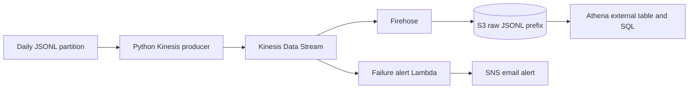

# Submission notes — Payments streaming and batch lab

## Part 1: architecture discussion

A ten-minute streaming lag makes driver locations, matching, surge multipliers, and passenger alerts stale. The platform should expose lag and consumer health, apply backpressure, and catch up or replay from the durable stream. A one-day batch delay makes dashboards and training features stale but usually leaves an active ride operational; reports should show their freshness and the batch job should be recoverable.

GPS uses MQTT through IoT Core because persistent device connections and high-volume small messages suit a managed MQTT broker. Invoking Lambda for every GPS ping would add invocation overhead and cost, while Lambda is better for asynchronous downstream tasks. A small startup can initially use an API service, a relational database, object storage, and scheduled SQL. It saves cost and operations but gives up independent scaling, low-latency aggregates, stream replay/state, and dedicated ML pipelines.

## Part 2: measured Athena evidence

Fill this from the actual Athena results and query details. Do not estimate or fabricate the account-specific values.

| Measurement | Result |
|---|---:|
| Raw event rows | 3,030,197 |
| Unique invoiceId | 1,000,000 |
| Exact duplicate rows | 30,197 (0.997% of raw rows) |
| Events over 1 hour late | 0 |
| Share of events over 1 hour late | 0% |

The executed query outputs are exported under `evidence/athena/`: turnover (30 merchant/currency rows), failure rate (12 method/device rows), peak hours (24 rows), event lateness, exact duplicates, and overall scale. The original `manifest.json` records Athena query IDs, measured scan bytes, runtime, and S3 result locations. The hand-written table's late-event query found 60,824 events over 60 seconds (2.01%) and none over one hour.

The largest successful turnover group was merchant `m-009` in UAH (currency 980): ₴310,259,259.21 across 87,115 payments. The highest method/device failure rate was QR on Android at 6.71%. Peak payment creation hour was 18:00–18:59 UTC with 80,338 payments.

| Query | JSON bytes scanned | JSON runtime | Parquet bytes scanned | Parquet runtime | Scan reduction |
|---|---:|---:|---:|---:|---:|
| Turnover | 1,260,692,423 (1.261 GB) | 3.645 s | 4,992,131 (4.992 MB) | 0.988 s | 252.5× |
| Failure rate | 1,260,692,423 (1.261 GB) | 3.570 s | 569,529 (0.570 MB) | 1.315 s | 2,213.6× |
| Peak hour | 1,260,692,423 (1.261 GB) | 4.551 s | 3,775,644 (3.776 MB) | 1.369 s | 333.9× |

Across these three queries, scanned bytes fell from 3.782 GB to 9.337 MB, a 405.1× scan reduction. Athena's on-demand scan price is $5/TB with a 10 MB minimum per query, so the approximate cost for these three queries is $0.0189 on JSON and $0.00015 on Parquet (about 126× after the minimum charge); see [Athena pricing](https://aws.amazon.com/athena/pricing/). Query runtimes were also lower for each Parquet query.

The Glue crawler created `payments_lab.crawler_payments` at the source prefix and recognized `dt` as a `string` partition. It inferred `amount`, `ccy`, `finalAmount`, and `mcc` as `int`; `createdDate`, `modifiedDate`, and `receivedAt` as `string`; and `failureReason` as `string` even though it is absent from most events. The manual schema also uses `string` for dates and numeric source fields, then casts values explicitly in the view. The manual schema is convenient when stable types and deliberate casts matter; crawler inference is quick but depends on sampled data and may not match the types an analyst wants.

**Why `DISTINCT` before `row_number()`:** an exact webhook redelivery should not compete with real status changes in the ranking. Deduplicating the complete event row first removes only identical copies; `row_number()` then chooses the latest distinct status event per invoice. Without this step, raw event totals and window counts are inflated, and tie-breaking between repeated copies is arbitrary. Deduplicating only by `invoiceId` would be worse: it would erase valid created/processing/success transitions before the latest event is selected.

## Part 3: local stream experiment log

One public daily partition (`dt=2026-10-01`) contained 101,084 event rows and 33,361 distinct invoice IDs. The consumer counted 1,001 exact duplicate event records in each complete run. Baseline and zero-grace replays used the requested 20 payments/s. Failure injection used 1,000 payments/s to shorten that experiment; the restart/group run used 100 payments/s so the producer was still active during the one-minute pause.

| Experiment | Output/evidence | What changed |
|---|---|---|
| Baseline; 2-minute grace | 4,431 method/window summaries; 32,807 terminal outcomes, 1,971 failures (6.01%); 1,651 events rejected after window closure; 910 alerts. Example: `ALERT method=card window=2026-10-01T00:01:00+00:00 failure_share=100.00% threshold=10%`. | Full one-day baseline at the requested 20 payments/s. |
| Stop consumer for 1 minute, restart same group | Paused the first consumer after 20 seconds while producer continued. Restarted with the same group ID; final committed offsets were 33,629 + 33,088 + 34,367 = 101,084, with zero lag. | No input records were lost; offsets resumed consumption. Window/dedup state is in memory, so the two process runs do not form one continuous aggregate. |
| Two consumers, same group | Redpanda reported 2 members: one assigned partitions 0 and 1, the other partition 2. After replay, total lag was 0 and group offsets reached the end of all 3 partitions. | Kafka split partitions between members. This simple consumer prints per-member window summaries; it does not merge window state across members. |
| 30% injected failure rate | Producer acknowledged all 101,084 events and reported exactly 10,008/33,361 payments (30.00%) selected for injection. Consumer counted 32,817 terminal outcomes, 11,181 failures (34.07%); 1,606 late events rejected; 3,407 alerts. | Failure injection was accelerated to 1,000 payments/s. The terminal failure share is above 30% because some unselected payments already failed naturally. |
| Zero grace; same 20 payments/s | 4,428 method/window summaries; 32,672 terminal outcomes, 1,964 failures (6.01%); 2,025 late events rejected; 911 alerts. The complete run acknowledged all 101,084 records, had zero consumer lag, and counted 1,001 exact duplicates. | Compared with the 120-second run at the same rate, zero grace rejected 374 more late events and admitted 135 fewer terminal outcomes; aggregate failure share stayed at 6.01%. |

The consumer's exact-event set is in memory and grows for the process lifetime. A production service uses state with a retention/TTL policy (or managed keyed state); restarting the local process clears that set, while Kafka's committed group offsets govern replay position. Thus the restart experiment proves that the log retains and replays records, but this teaching consumer does not restore aggregate window state after a process restart. The results above are for one day only and must not be presented as the full-month Part 2 totals.

## Part 4: cloud pipeline and comparison

The local pipeline runs a Kafka-compatible broker and a Python consumer on one laptop, so the operator owns broker availability, process state, and aggregation behavior. The cloud version uses managed Kinesis and Firehose, writes durable files to S3 for Athena, and triggers SNS alerts through Lambda. It removes local broker operations and integrates with AWS, but incurs stream shard-hour, Firehose ingestion/delivery, Lambda, S3, Athena scan, and possible notification costs. In this lab's one-shard template, the Kinesis shard is the fixed baseline cost while it exists; Firehose also has a minimum billable throughput in some regions and billing modes. Record actual cost from Billing/Cost Explorer after the run; delete the stack immediately afterward to stop ongoing stream charges.

| Evidence | Value |
|---|---|
| Athena screenshot/CSV over `stream/raw/` | Not produced: the account's Kinesis `ListStreams` API returns `SubscriptionRequiredException`, so the cloud stream could not be created. |
| Kinesis + Firehose active duration | 0; no stream resources were created. |
| AWS cost shown for experiment | No stream cost incurred. Athena query estimates above cover Part 2 only. |
| CloudFormation/SAM stack deleted | No Kinesis/Firehose stack was deployed. The Glue crawler stack is separate and remains available for the completed Part 2 comparison. |

